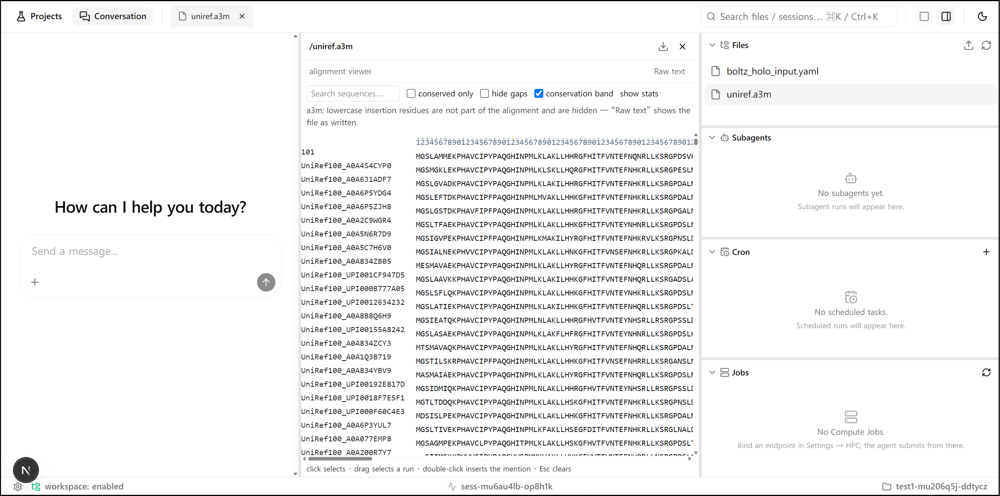
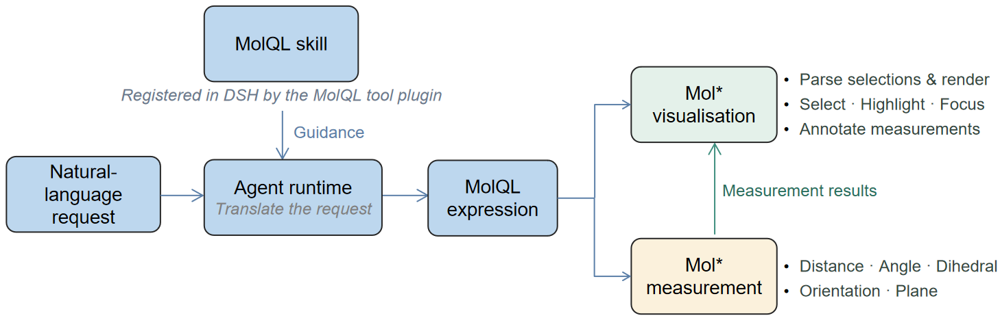
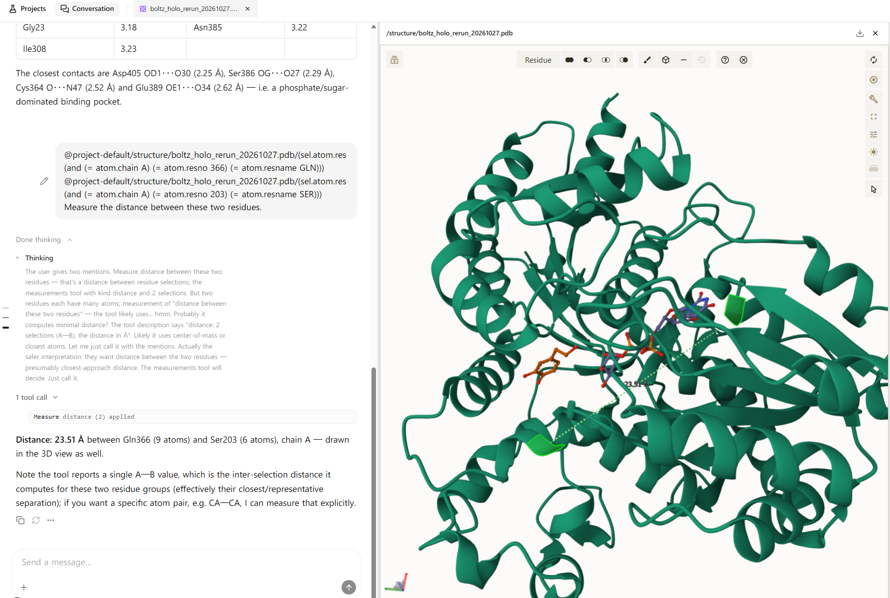
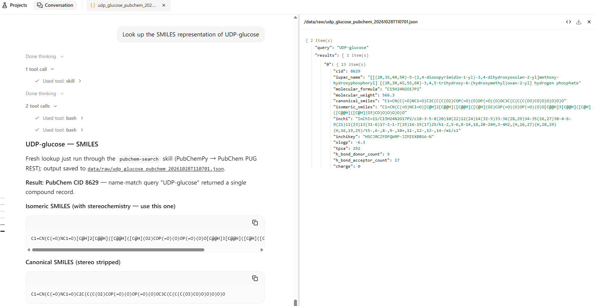
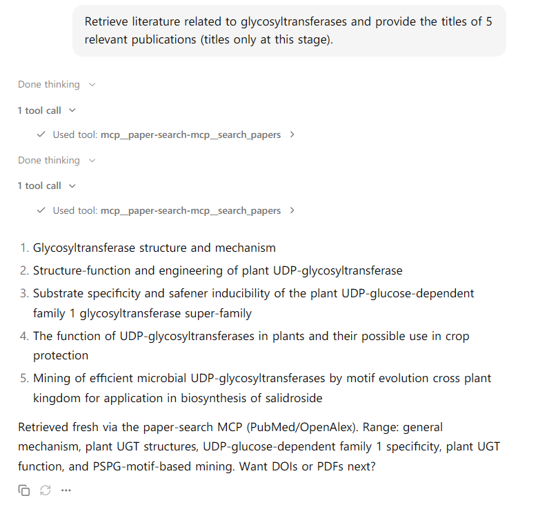
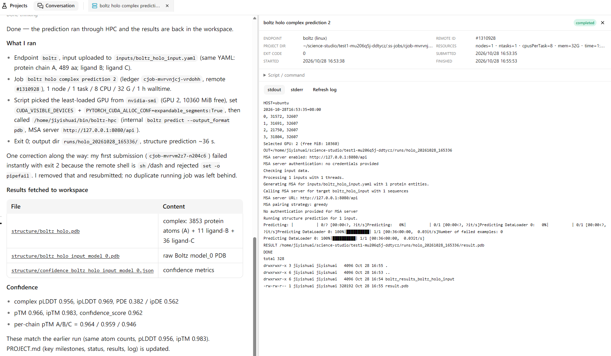

# Generative Protein System

> 中文: [README.zh.md](./README.zh.md)

## Overview

Generative Protein System is an agentic research workbench for protein design. It brings structure and sequence analysis, scientific tools, remote computation, and research records into a shared project environment. Researchers can conduct analyses through conversation, inspect evidence in structure and sequence views, and retain files and analytical histories for subsequent work.

It supports browser access and desktop clients for Windows, macOS, and Linux.

## Installation and quick start

### Prerequisites

- Node.js 22.12+
- npm and Git
- `dsh` installed and available on PATH

Model provider, model, endpoint, and credentials are configured in the
workbench **Settings → Model** after the application starts.

### Web application

Install dependencies and build the packages, service, and web app:

```bash
npm install
npm run build
npm run build -w @gps/web
```

Create `services/transport-service/.env` from the
[configuration example](./services/transport-service/.env.example) and set the
projects directory:

```dotenv
PROJECT_ROOT=/absolute/path/to/projects
# Optional: credentials supplied through the environment
# DEEPSEEK_API_KEY=<your-deepseek-api-key>
# OLLAMA_LOCAL_API_KEY=ollama
```

`.env` configures paths and optional credentials only; the model route is
configured in the workbench, not in `.env`.

Start the service and web app in separate terminals:

```bash
npm start -w @gps/transport-service
npm start -w @gps/web
```

Open <http://127.0.0.1:3000>. If no model is configured yet, open
**Settings → Model**, enter the provider, model, endpoint, and credentials,
then save and restart the service if prompted.

Natural-language structure analysis also requires the
[MolQL tool plugin](./packages/plugins/molql-tool-dsh/README.md). External
scientific services and remote computation are configured in the workbench's
MCP and HPC settings.

### Desktop client

The desktop client requires `dsh` on PATH and Git for worktrees. It starts its
own local service and web server.

Build the installer on the target operating system:

```bash
npm install
npm run pack -w @gps/desktop
```

The installer is written to `apps/desktop/release` (Windows NSIS, macOS DMG,
Linux AppImage or DEB). Install and open it; no further terminal command is
needed. On first use, configure the model in **Settings → Model** if none is
set.

## Features

### Research dashboard

The workbench brings agent conversations, file viewing, and research activities into one interface. Central tabs display molecular structures, sequence alignments, and analysis files, while the side panel provides access to project files, subagents, scheduled tasks, and Compute Jobs. Researchers can inspect data, track execution progress, and review results alongside the conversation.



*Figure 1. Research dashboard with the agent conversation on the left, a sequence alignment in the centre, and project files and research activities on the right.*

### Projects and research records

Each project brings together data, scripts, analytical outputs, and sessions. Worktrees separate alternative analyses into independent checkouts; sessions in the same worktree use a common working directory.

Sessions preserve messages and tool calls, subagent records retain delegated activities and results, and remote Compute Jobs are stored at the project level. The agent can also maintain a `PROJECT.md` brief with research objectives, progress, findings, and open questions to support continuity across sessions.

### Structure and sequence analysis

The integrated Mol* structure viewer supports natural-language selection, highlighting, and focusing. For example, ask the agent to show residues within 4 Å of a ligand or analyse non-covalent interactions involving a selected region.



*Figure 2. MolQL interaction workflow: the agent translates natural-language requests into selection expressions for structure visualisation and geometric measurements.*

You can also select residues or atoms directly in the 3D view, insert their references into the conversation, and request distance, angle, or dihedral measurements. Results appear in both the conversation and the structure view.



*Figure 3. Interactive distance measurement: residues selected in the structure viewer are referenced in a request, with the result shown in both the conversation and the 3D view.*

The multiple-sequence-alignment viewer supports formats including Clustal, Stockholm, FASTA, and A3M. It displays conservation and gap patterns and lets you reference sequence positions in the conversation for analysis alongside structural evidence. These statistics describe sequence variation in the alignment and do not directly predict mutation tolerance.

### Skills and MCP

Skills provide reusable procedural guidance for tasks such as input preparation, tool use, and result checking. Global Skills can be shared across projects, while project Skills retain conventions for a particular investigation.



*Figure 4. Skill example: the agent follows PubChem search guidance to retrieve the SMILES representation of UDP-glucose and save the results.*

MCP connects external tools and data services, such as literature search, database queries, and prediction services. Available capabilities depend on the configured servers. Both Skills and MCP can be managed through the workbench settings.



*Figure 5. MCP example: the agent calls a literature search service to retrieve publications related to glycosyltransferases.*

### Remote computation

Generative Protein System connects to Slurm clusters and remote Linux hosts. The agent can submit scripts or commands, inspect execution status and logs, request cancellation, and transfer input and output files as needed. Scientific software must be prepared on the remote system.

Each submission creates a persistent Compute Job record containing the submitted computation, remote identifier, and execution state. Researchers can inspect jobs in the workbench after the initiating session has ended.



*Figure 6. Remote computation example: a Boltz structure prediction with its Compute Job record, execution logs, and retrieved output files.*

## License

Generative Protein System is licensed under the [Apache License 2.0](./LICENSE). Third-party dependencies retain their respective licenses.
