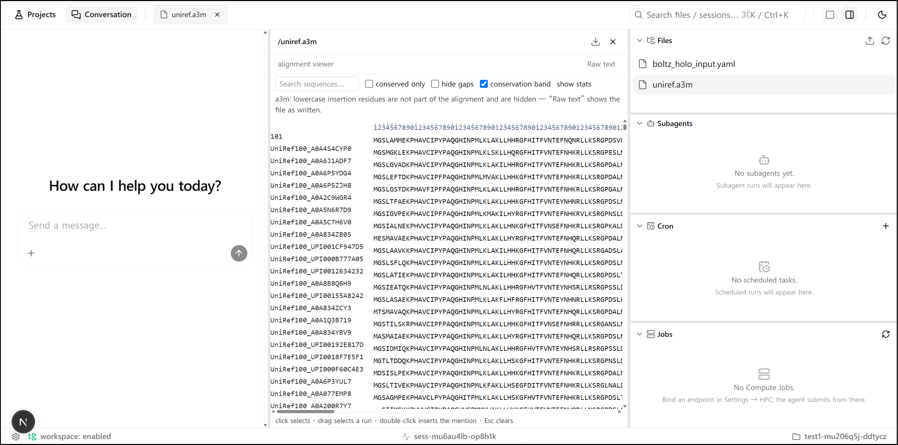
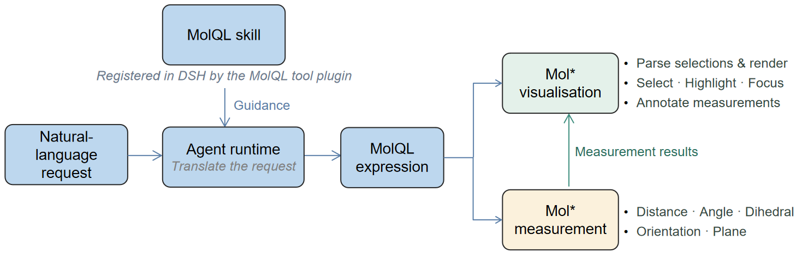
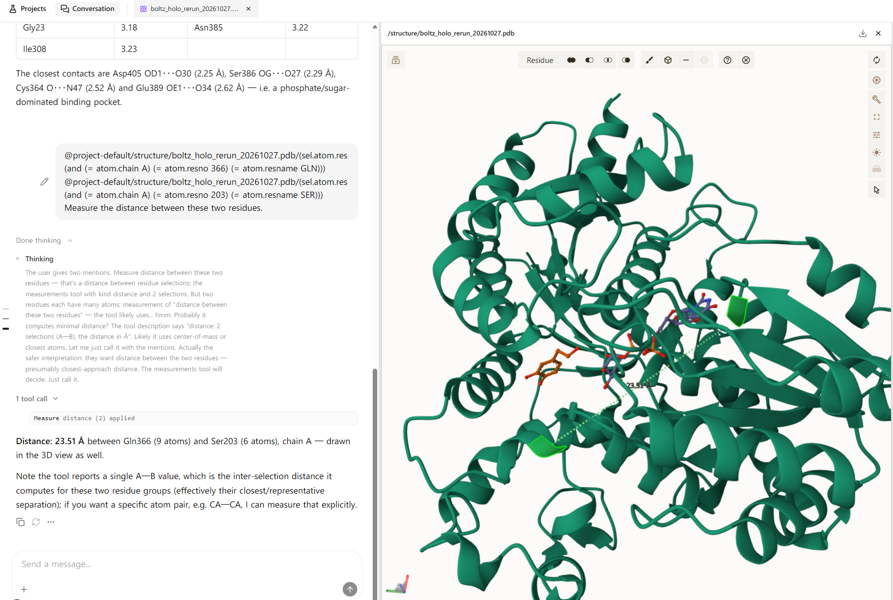
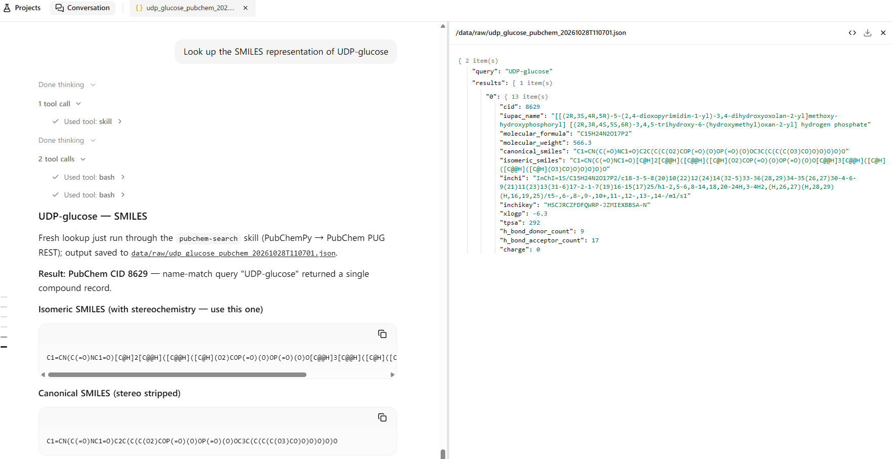
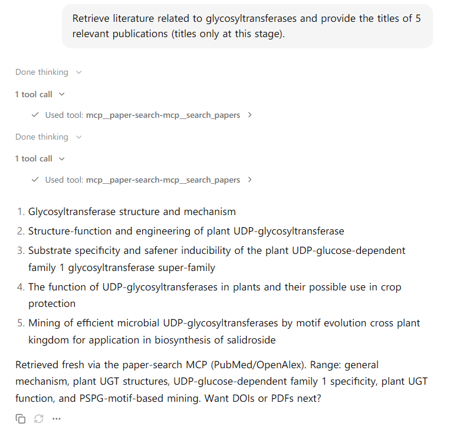
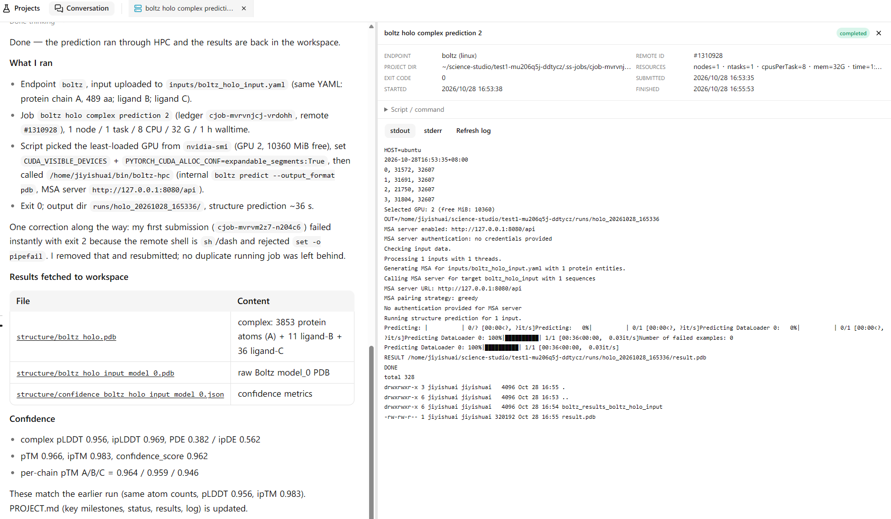

# Generative Protein System

> English: [README.md](./README.md)

## 简介

Generative Protein System 是面向蛋白质设计的智能体科研工作台，将结构与序列分析、科学工具、远程计算和研究记录组织在同一项目中。研究人员可以通过对话开展分析，在结构和序列视图中检查证据，并保留研究文件与分析过程，供后续工作继续使用。

支持浏览器访问，以及 Windows、macOS 和 Linux 桌面客户端。

## 安装与快速开始

### Web 部署

需要 Node.js 22.12+、npm、Git，以及与项目锁定的
`@deepseek-ai/dsh-sdk-client`（`0.1.5-alpha.1`）兼容的 `dsh` CLI。模型 route
在 harness 侧 `~/.dsh/settings.yaml` 中声明。

在仓库根目录安装依赖并构建 workspace 包和 service：

```bash
npm install
npm run build
```

开发模式下这样已经够用：`next dev` 会按需编译 Web 应用。

参考 [配置示例](./services/transport-service/.env.example)，创建
`services/transport-service/.env`：

```dotenv
TRANSPORT_RUNTIME=dsh
PROJECT_ROOT=/absolute/path/to/projects
# 为实际配置的 route 填凭据：
# OLLAMA_LOCAL_API_KEY=ollama
# DEEPSEEK_API_KEY=<your-deepseek-api-key>
```

- `PROJECT_ROOT` 是所有 Project workspace 的父目录；default 项目位于
  `<PROJECT_ROOT>/project-default`。Windows 使用 `D:/GPS/projects`，路径含
  空格时加引号；WSL 使用 `/mnt/d/GPS/projects`。
- 服务不会硬编码模型 provider。它会依次采用：工作台
  Settings → Model、`~/.dsh/settings.yaml` 的 `agent-default-model`、
  唯一配置的 `llm-pi-ai` route。都没有时才回退到内置的
  `deepseek-official`/`deepseek-v4-flash`，这需要 `DEEPSEEK_API_KEY`。
- 如果使用本地 Ollama，需要在 `~/.dsh/settings.yaml` 同时写入默认选择和
  pi-ai route（见下）。Ollama 会忽略凭据内容，但 harness 要求
  `OLLAMA_LOCAL_API_KEY` 非空。
- 如果改用 DeepSeek，在 `.env` 中填 `DEEPSEEK_API_KEY`，并这样启动：
  `DSH_PROVIDER=deepseek-official DSH_MODEL=deepseek-v4-flash`。
- `OPENCLAW_*` 变量是 legacy，dsh 模式不需要。
- `DSH_*` 变量只能放在启动环境里，不能写进 `.env`：harness 子进程会读取
  该目录的 `.env`，并拒绝这些名字。

provider route 本身写在 `~/.dsh/settings.yaml`，例如：

```yaml
agent-default-model:
  provider: ollama-local
  model: qwen3.8:latest

llm-pi-ai:
  providers:
    ollama-local:
      api: openai-completions
      baseURL: http://localhost:11434/v1
      models: [{ id: qwen3.8:latest }]
      apiKeyEnv: OLLAMA_LOCAL_API_KEY
```

启动 service 和 Web：

```bash
npm run dev
```

`npm run dev:dsh` 也可以，并且会额外强制使用 dsh runtime。打开
[http://localhost:3000](http://localhost:3000)，创建项目和会话，即可开始使用。

生产 Web 需要单独构建 `apps/web`；根目录的 `npm run build` 只构建 workspace
包和 service：

```bash
npm run build -w @gps/web
npm start -w @gps/web
```

自然语言结构分析还需要部署
[MolQL 工具插件](./packages/plugins/molql-tool-dsh/README.md)。外部科学服务和
远程计算分别在工作台的 MCP、HPC 设置中配置。

### 桌面客户端

桌面客户端自动启动并管理本地服务，无需另外运行 Web 服务。需要本机能够通过 PATH 找到 `dsh`，并已安装 Git 以使用工作分支功能。

完成上述依赖安装和构建后，可从源码构建并启动客户端：

```bash
npm run start -w @gps/desktop
```

启动后，在工作台设置中配置模型服务。项目默认保存在用户目录下的 `Documents/Generative Protein System/projects`。

如需生成安装包，在目标操作系统上运行：

```bash
npm run pack -w @gps/desktop
```

支持 Windows x64 NSIS、macOS DMG，以及 Linux AppImage 和 DEB。

## 主要功能

### 研究工作台

工作台将智能体对话、文件查看和研究活动集中在同一界面。中央标签页支持查看分子结构、序列比对和分析文件，侧边面板提供项目文件、子智能体、定时任务和计算作业入口，便于在对话过程中检查数据、跟踪执行进展并查看结果。



*图 1. 研究工作台：左侧为智能体对话，中央为多序列比对视图，右侧为项目文件与研究活动面板。*

### 项目与研究记录

每个项目集中保存数据、脚本、分析结果和会话。工作分支（Worktree）用于分开探索不同的分析方案；同一工作分支中的会话使用共同的工作目录。

会话保存消息与工具调用，子智能体记录保留委派过程和结果，远程计算作业则独立保存在项目中。智能体还可维护 `PROJECT.md`，记录研究目标、进展、发现和待解决的问题，便于跨会话继续研究。

### 结构与序列分析

内置 Mol* 分子结构视图，支持通过自然语言选择、突出显示和聚焦结构区域。例如，可以要求智能体显示配体周围 4 Å 内的残基，或分析指定区域的非共价相互作用。



*图 2. MolQL 交互流程：智能体将自然语言请求转为选择表达式，用于结构显示与几何测量。*

也可以直接在三维视图中选择残基或原子，将其引用带入对话，再进行距离、角度和二面角等测量。测量结果同时显示在对话和结构视图中。



*图 3. 交互式距离测量：在结构视图中选择残基后发起测量，结果同时显示在对话和三维视图中。*

多序列比对视图支持 Clustal、Stockholm、FASTA 和 A3M 等格式，提供保守性与 gap 分布显示，并可将序列位置引用到对话中，结合结构信息进一步分析。这些统计用于描述比对中的序列差异，不直接预测突变耐受性。

### Skills 与 MCP

Skills 为智能体提供可复用的科研操作指导，例如输入准备、工具使用和结果检查。全局 Skills 可供多个项目使用，项目 Skills 则保存当前研究的操作约定。



*图 4. Skills 使用示例：智能体遵循 PubChem 检索指导，查询 UDP-glucose 的 SMILES 并保存结果。*

MCP 用于接入外部工具和数据服务，例如文献检索、数据库查询和预测服务。可用能力取决于配置的服务器。Skills 和 MCP 均可通过工作台设置管理。



*图 5. MCP 使用示例：智能体调用文献检索服务，获取糖基转移酶相关论文。*

### 远程计算

支持连接 Slurm 集群和远程 Linux 主机。智能体可以提交计算脚本或命令、查看执行状态与日志、请求取消计算，并按需传输输入和结果文件。具体科学软件需要在远端准备。

每次提交都会生成持久化的计算作业记录，保存提交内容、远程标识和执行状态。研究人员可以在工作台中检查作业，即使发起计算的会话已经结束。



*图 6. 远程计算示例：提交 Boltz 结构预测，查看计算作业记录、执行日志与返回的结果文件。*

## 许可证

Generative Protein System 采用 [Apache License 2.0](./LICENSE)。第三方依赖遵循各自的许可证。
